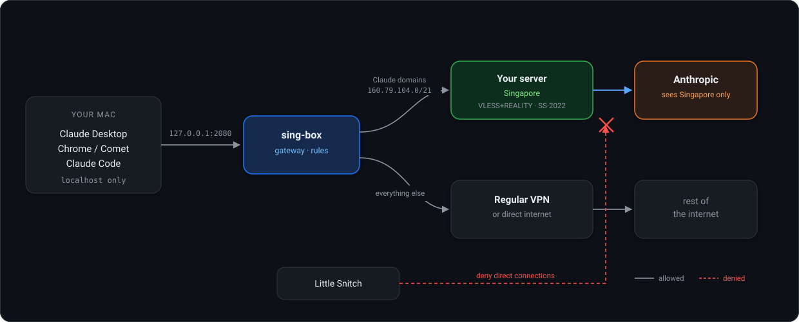

<div align="center">

# Block Claude Ban

**Claude through your own server only. If the tunnel drops, traffic stops — it does not leak.**

*RU: Claude только через свой сервер. Оборвался канал — оборвался трафик, а не утёк напрямую.*


[English](README.md) · [Русский](README.ru.md)

</div>

---

## Why

Claude is unavailable in some countries, and the usual advice is "turn on a VPN". The
problem is that VPNs drop: after sleep, on Wi-Fi change, on reconnect. In that second
Claude is already sending a request from your real address — and the account sees a
country change.

This repository builds a setup where such a leak is impossible **by design**, not by
discipline:

- Claude domains go **only** through your own server in the required country;
- there is no fallback "direct" route for them;
- if the tunnel dies, the connection fails or freezes, it never goes around;
- the rest of the internet keeps working as before, through your existing VPN.

## How it works



The gateway is the only component that decides where traffic goes. Direct access to
Anthropic is blocked by the firewall, so even an app that ignores the proxy cannot
bypass it.

## What is inside

| Component | Role |
|---|---|
| `bin/claude-net` | gateway control: start/stop/status/check/trace/use |
| `bin/claude-desktop` | launches Claude Desktop through the proxy, waits for the gateway |
| `bin/claude-safe` | Claude Code: exit-IP preflight + macOS sandbox |
| `bin/chrome-claude` | Chrome with a dedicated profile, timezone and language |
| `bin/comet-claude` | the same for Comet |
| `bin/claude-app-guard.sh` | watchdog: keeps Claude from running outside the gateway |
| `server/install-sg-server.sh` | VLESS+REALITY node installer for a VPS |
| `sandbox/` | sandbox profile and a timezone/fingerprint check page |
| `docs/` | architecture, server, troubleshooting |

## Quick start

### 1. Server

```bash
scp server/install-sg-server.sh root@YOUR_SERVER_IP:/root/
ssh root@YOUR_SERVER_IP 'bash /root/install-sg-server.sh'
```

The script installs sing-box, generates REALITY keys and prints a ready `outbound`
block. Details: [docs/en/SERVER.md](docs/en/SERVER.md).

### 2. Client

```bash
git clone https://github.com/lol-lol-lol-lol/Block-Claude-Ban.git
cd Block-Claude-Ban
./install.sh
```

It downloads sing-box, installs the scripts, sets up autostart and the "Claude SG"
shortcut.

### 3. Configuration

```bash
cp config.example.json ~/vpn/claude-net/config.json
$EDITOR ~/vpn/claude-net/config.json    # YOUR_SERVER_IP, YOUR_SS_PASSWORD, backup
```

### 4. Verify

```bash
claude-net check     # gateway is up, chain works
claude-net trace     # what Anthropic actually sees
```

## Commands

```bash
claude-net start | stop | restart | status
claude-net check              # direct exit, chain exit, claude.ai, api
claude-net trace              # Cloudflare trace via chain and directly
claude-net use sg-vps         # primary outbound
claude-net use backup         # backup, manual only
claude-net web                # open the check page in the browser
```

## Three layers of protection

| Layer | Covers | Does not cover |
|---|---|---|
| **Gateway** | routing: Claude domains via the server only, no direct fallback | an app that ignores the proxy entirely |
| **Little Snitch** | direct connections to Anthropic from any process | connections inside a local proxy (localhost is not filtered) |
| **Sandbox** | Claude Code can only reach localhost | other applications |
| **Watchdog** | Claude Desktop cannot live without the proxy | a ~10 s window on a wrong launch |

Leak test:

```bash
claude-net stop
curl https://api.anthropic.com/v1/models   # must fail to connect
claude-net start
```

## Honest limits

- **Single server.** If it dies, Claude stops. The backup is switched manually so the
  country never changes mid-session.
- **Not absolute privacy.** This changes your address, it does not change the service's
  rules.
- **Timezone, language and WebRTC** are separate signals. `sandbox/tz-check.html` shows
  what a website can read.
- **Not a tool for breaking the law.** You are responsible for how you use it.

## Documentation

- [docs/en/ARCHITECTURE.md](docs/en/ARCHITECTURE.md) — how and why
- [docs/en/SERVER.md](docs/en/SERVER.md) — server: ports, panel, subscriptions
- [docs/en/TROUBLESHOOTING.md](docs/en/TROUBLESHOOTING.md) — when it does not work
- [SECURITY.md](SECURITY.md) — secrets, panel hardening, limits
- Русская версия: [docs/](docs/)

---

<sub>**Keywords / Ключевые слова:** Claude не работает в России · обход блокировки Claude · Claude без VPN · VPN для Claude · Claude Desktop через прокси · Claude Code песочница · kill switch · утечка IP · маршрутизация по домену · обход DPI · VLESS REALITY · sing-box · 3x-ui · Shadowsocks · split tunneling · macOS</sub>

## License

[MIT](LICENSE) © 2026 lol-lol-lol-lol
