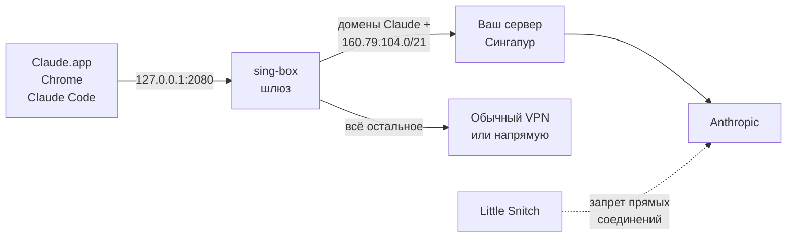

<div align="center">

# Block Claude Ban

**Claude только через свой сервер. Оборвался канал — оборвался трафик, а не утёк напрямую.**


[English](README.md) · [Русский](README.ru.md)

</div>

---

## Зачем это

Claude не работает из ряда стран, и обычно советуют «включи VPN». Проблема в том, что
VPN рвётся: после сна, при смене Wi-Fi, на переподключении. В эту секунду Claude уже
отправляет запрос с вашего настоящего адреса — и аккаунт видит смену страны.

Этот репозиторий собирает схему, в которой такой утечки нет **по устройству**, а не по
надежде на дисциплину:

- домены Claude идут **только** через ваш сервер в нужной стране;
- запасного маршрута «напрямую» у них нет;
- если канал упал — соединение обрывается или замирает, но не уходит в обход;
- остальной интернет работает как обычно, через ваш прежний VPN.

## Как устроено



Шлюз — единственная точка, которая знает, куда идти. Прямой доступ к Anthropic закрыт
фаерволом, поэтому даже приложение, игнорирующее прокси, не сможет уйти в обход.

## Что внутри

| Компонент | Роль |
|---|---|
| `bin/claude-net` | управление шлюзом: start/stop/status/check/trace/use |
| `bin/claude-desktop` | запуск Claude Desktop через прокси, с ожиданием шлюза |
| `bin/claude-safe` | Claude Code: проверка выходного IP + песочница macOS |
| `bin/chrome-claude` | Chrome с отдельным профилем, часовым поясом и языком страны |
| `bin/comet-claude` | то же для Comet |
| `bin/claude-app-guard.sh` | сторож: не даёт Claude работать мимо шлюза |
| `server/install-sg-server.sh` | установка узла VLESS+REALITY на VPS |
| `sandbox/` | профиль песочницы и страница проверки часового пояса |
| `docs/` | архитектура, сервер, разбор проблем |

## Быстрый старт

### 1. Сервер

```bash
scp server/install-sg-server.sh root@YOUR_SERVER_IP:/root/
ssh root@YOUR_SERVER_IP 'bash /root/install-sg-server.sh'
```

Скрипт поднимает sing-box, генерирует REALITY-ключи и печатает готовый блок `outbound`.
Подробнее — [docs/SERVER.md](docs/SERVER.md).

### 2. Клиент

```bash
git clone https://github.com/lol-lol-lol-lol/Block-Claude-Ban.git
cd Block-Claude-Ban
./install.sh
```

Установщик скачает sing-box, разложит скрипты, поставит автозапуск и ярлык «Claude SG».

### 3. Конфиг

```bash
cp config.example.json ~/vpn/claude-net/config.json
$EDITOR ~/vpn/claude-net/config.json    # YOUR_SERVER_IP, YOUR_SS_PASSWORD, резерв
```

### 4. Проверка

```bash
claude-net check     # шлюз жив, цепочка работает
claude-net trace     # что видит Anthropic
```

## Команды

```bash
claude-net start | stop | restart | status
claude-net check              # прямой выход, выход цепочки, claude.ai, api
claude-net trace              # Cloudflare trace через цепочку и напрямую
claude-net use sg-vps         # основной выход
claude-net use backup         # резерв, вручную
claude-net web                # страница проверки в браузере
```

## Три слоя защиты

| Слой | Что закрывает | Что не закрывает |
|---|---|---|
| **Шлюз** | маршрут: домены Claude только через сервер, без запасного «напрямую» | приложение, которое вообще не слушает прокси |
| **Little Snitch** | прямые соединения любого процесса к Anthropic | соединения через локальный прокси (localhost не фильтруется) |
| **Песочница** | Claude Code ходит только на localhost | остальные приложения |
| **Сторож** | Claude Desktop не живёт без прокси | окно ~10 с при неправильном старте |

Проверка «обрыв не течёт»:

```bash
claude-net stop
curl https://api.anthropic.com/v1/models   # должно быть ошибкой соединения
claude-net start
```

## Честно о границах

- **Один сервер.** Упал — Claude встал. Резерв переключается вручную, чтобы страна
  не менялась посреди сессии.
- **Приватность не абсолютна.** Схема меняет адрес, но не отменяет правила сервиса.
- **Часовой пояс, язык и WebRTC** — отдельные сигналы. В репозитории есть страница
  `sandbox/tz-check.html`, которая показывает, что видит сайт.
- **Не для обхода закона.** Ответственность за использование — на вас.

## Документация

- [docs/ARCHITECTURE.md](docs/ARCHITECTURE.md) — как всё устроено и почему
- [docs/SERVER.md](docs/SERVER.md) — сервер: порты, панель, подписки
- [docs/TROUBLESHOOTING.md](docs/TROUBLESHOOTING.md) — что делать, когда не работает
- [SECURITY.ru.md](SECURITY.ru.md) — секреты, защита панели, границы схемы

## Лицензия

[MIT](LICENSE) © 2026 lol-lol-lol-lol
